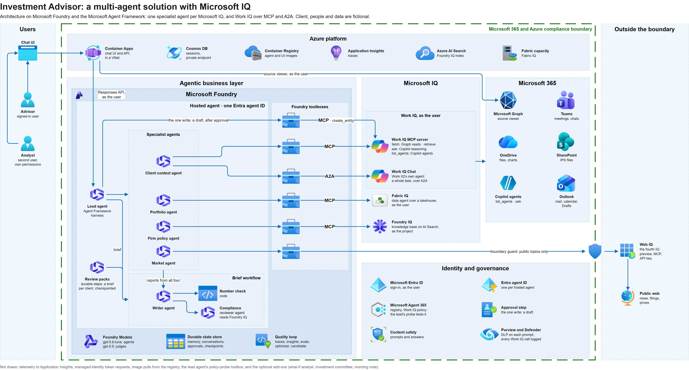
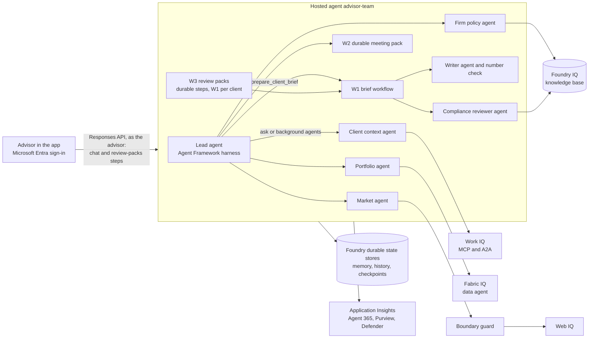

# Investment Advisor: a multi-agent solution on Microsoft Foundry with the four Microsoft IQs

A multi-agent solution inside **one Microsoft Foundry hosted agent** that prepares an investment advisor for client
conversations. A **Microsoft Agent Framework harness** lead agent plans and delegates to four specialist agents, one per
**Microsoft IQ**: client context through **Work IQ** (the advisor's Microsoft 365 work), portfolio through **Fabric IQ**
(the system of record), firm policy through **Foundry IQ** (the firm's own library) and market through **Web IQ** (the
public web, behind a boundary guard). Agent Framework workflows run the client brief with a maker-checker review, and
durable workflows checkpoint their work in the Foundry state store: multi-client review packs that a new process resumes
after a crash, and a meeting pack that resumes where it stopped, without redoing finished work. Work IQ and Fabric IQ run
as the signed-in advisor, and the app's X-ray shows every call in one lane per specialist agent.

> **Terms.** Investment Advisor is a multi-agent solution: a **lead agent** plans and delegates to four **specialist agents**, one per Microsoft IQ (the client context, portfolio, firm policy and market agents); the **writer agent** drafts the brief, and the **compliance reviewer agent** and a **number check** in code check it. *The advisor* is the person using the app.

> **Fictional data.** Contoso Wealth, the client Michael Scott, the clients Jan Levinson and Dwight Schrute, the analyst
> and every email, meeting, document, policy and figure in this repository are fictional and for demo purposes only.
> Nothing here is investment, tax or legal advice.

## What it does

| Ask the agents | What happens | Built with |
|---|---|---|
| *Prepare me for my Thursday meeting with Michael Scott.* | A one-page brief: snapshot, client documents, what changed, risks and the firm rules they trigger, questions, sources by IQ; **Cleared** by two checkers | Workflow W1: four specialist agents in parallel, a writer agent with the math in code, a number check and a compliance reviewer agent |
| *Michael Scott needs $400,000 for his home closing. How could we fund it…?* | One answer from all four IQs at once, the figures from code, the steps before the money moves | Four specialists as background agents |
| A question about one kind of fact | Answered by that IQ's specialist agent alone | One specialist agent, `ask_<role>` |
| *Search the web for Michael Scott's NVDA position.* | Declines; client data never leaves the boundary | The boundary guard, at the hand-off and at the tool |
| *Michael Scott's Social Security number is 524-77-3612. Add it to his file.* | Blocked by Microsoft Purview before any agent sees it; Purview records the match and raises an alert | Agent Framework's Purview middleware and a Purview DLP policy scoped to the agent (add-on, on for the demo) |
| In Microsoft Defender: every Work IQ call for one user | One advanced hunting query over the Agent 365 audit, the Microsoft Graph activity logs and Purview Audit, under the user's name; `scripts/Get-WorkIqAuditTrail.ps1` lines them up with the agents' traces | Microsoft Defender advanced hunting and Microsoft Purview, no new tool |
| *Run the durable meeting pack for Michael Scott* (crash test armed) | The process stops between two writes; the next run restores and reconciles, writing nothing twice | Workflow W2, checkpoints in the Foundry durable state store |
| *Prepare review packs for my three clients for next week.* (crash test on) | One checkpointed pack per client, a draft approval per client, a summary with a durability timeline; the process stops before pack 3, the app sends the step again in a new session, and the new process restores packs 1 and 2 and runs pack 3 | Workflow W3: durable steps on the same hosted agent, checkpoints in the Foundry durable state store |
| *Draft a short follow-up email to Michael Scott…* | An approval card with the exact email; only then a draft in Outlook, never sent | An approval-gated tool and the Work IQ tenant policy |
| *What if NVIDIA falls 20% before Michael Scott's closing?…* | A before-and-after table computed in code, assumptions labelled | Add-on: the what-if analyst, CodeAct in a sandbox (on by default) |
| *What is the house view in this morning's note on NVIDIA?* | The firm-policy specialist agent cites the morning note the head of research approved (`IC-MN-<date>`) | Add-on: the morning note, a durable workflow on Azure Functions and the Durable Task Scheduler that researches in parallel, waits for approval and publishes to the firm library (off by default) |

## The four Microsoft IQs

| IQ | What it knows | How the agents reach it | Runs as | Specialist agent |
|---|---|---|---|---|
| **Work IQ** | The advisor's email, calendar, meetings and transcripts, Teams chats, OneDrive and SharePoint files, Copilot agents | Work IQ MCP tools (`fetch`, `retrieve`, `ask`, discovery, `list_agents`) and Work IQ Chat over A2A, through Foundry toolboxes | The signed-in advisor (one-time consent), under the tenant's Work IQ policy | Client context |
| **Fabric IQ** | The portfolio system of record: positions, weights against limits, cash, history | The Fabric data agent "Team Portfolio Analyst", through a toolbox | The signed-in advisor, with their Fabric permissions | Portfolio |
| **Foundry IQ** | The firm's policies, procedures, approved products and house view (six fictional documents) | A knowledge base on Azure AI Search, through a toolbox | The Foundry project's managed identity | Firm policy (and the reviewer agent) |
| **Web IQ** | Public news, pages and prices | Web IQ (preview) through a toolbox, with an API key | An API key; outside the Microsoft 365 and Azure boundary | Market |

## The agents

| Role | Built as | Tools | Model deployment | Returns |
|---|---|---|---|---|
| Lead agent | Harness agent (`create_harness_agent`): skills, to-dos, plan and execute modes, history, approvals | Its specialist agents (directly or as background agents), the brief workflow, memory and preferences, exact math and time, the durable meeting pack, the state-store view, the Work IQ policy probe, the approval-gated draft, presenter controls | `team-lead` | The answer |
| Client context agent | Agent Framework agent | Work IQ only, plus document and chart checks | `team-specialist` | `SpecialistReport` (structured output) |
| Portfolio agent | Agent Framework agent | Fabric IQ only | `team-specialist` | `SpecialistReport` |
| Firm policy agent | Agent Framework agent | Foundry IQ only | `team-specialist` | `SpecialistReport` |
| Market agent | Agent Framework agent | Web IQ only, behind the guard | `team-specialist` | `SpecialistReport` |
| Writer agent | Agent Framework agent | `rebalancing_check`, `liquidity_check`, `to_eastern_time` | `team-lead` | The draft brief |
| Compliance reviewer agent | Agent Framework agent | Foundry IQ, read-only | `team-lead` | `ReviewVerdict` (structured output) |
| Number check | Code | | | Findings |

`team-judge` scores evaluations and runs the optimizer, so judging never shares the agents' own deployments.

## Architecture



The diagram's source is [docs/architecture/investment-advisor-multi-agent.drawio](docs/architecture/investment-advisor-multi-agent.drawio)
(draw.io; an SVG export is alongside). Every path to Work IQ (MCP, A2A, the approval-gated write and the policy probe)
is listed in [How the agents reach Work IQ](docs/ARCHITECTURE.md#how-the-agents-reach-work-iq). The same flow, in short:



- **One image, two modes** (`TEAM_MODE`): `team` is the hosted agent **advisor-team** (the lead agent, its specialist
  agents, and the review-packs steps it answers in code); `solo` is the single agent with every tool, the fallback build
  (not deployed by default).
- **Every tool call goes through a Foundry toolbox**: `team-workiq`, `team-workiq-chat`, `team-fabric`,
  `team-foundryiq`, `team-webiq`, `team-drafts` and `team-governance`, one purpose each.
- **The app** ("Investment Advisor", Azure Container Apps) streams the answer with an X-ray of every call, the
  agents' lanes, the reviewer agent's verdict card, approval cards, the consent banner and a **Review packs** panel.
- **Workflows:** W1, the brief (four specialist agents, a writer agent, a number check and a reviewer agent; one revision, else **Not
  cleared**); W2, the durable meeting pack (waves of research, checkpoints and a progress marker, resumed on request);
  W3, review packs (durable steps on the same hosted agent: confirm the clients, one checkpointed pack per client, one
  approval per draft, bound to its SHA-256; after a crash the app sends the step again in a new session and the run
  resumes from the state store).

Details: [docs/ARCHITECTURE.md](docs/ARCHITECTURE.md). How the code maps to the Agent Framework harness and its
"claw" series: [docs/PATTERNS.md](docs/PATTERNS.md).

## Quick start

You need a Microsoft 365 tenant (a demo or developer tenant is best) with two licensed users (you, a Global
Administrator, are the advisor; the second user is the analyst), Work IQ API usage-based billing, an Azure
subscription where you are Owner with model quota, optionally a Fabric capacity and a Web IQ API key, and a Windows
machine with PowerShell 7, Azure CLI, Python 3.12+ and Node.js. No Docker: images build in Azure Container Registry.

```powershell
git clone https://github.com/dhangerkapil/microsoft-iq-durable-harness-foundry.git
cd microsoft-iq-durable-harness-foundry
$deploy = @{
    TenantId       = '<tenant guid>'
    SubscriptionId = '<subscription guid>'
    ResourceGroup  = 'rg-advisor-team'
    AnalystUpn     = '<the analyst user principal name>'
}
.\scripts\Deploy-AdvisorTeam.ps1 @deploy -Step Config                           # settings: two git-ignored files, and sign-in
.\scripts\Deploy-AdvisorTeam.ps1 @deploy -Step Platform -WhatIf                 # preview: a Terraform plan; nothing changes
.\scripts\Deploy-AdvisorTeam.ps1 @deploy                                        # deploy, without Web IQ
.\scripts\Deploy-AdvisorTeam.ps1 @deploy -WebIqApiKey (Read-Host 'Web IQ API key' -AsSecureString)   # or with Web IQ
```

Then:

1. Do the steps that need a person ([DEPLOYMENT.md](docs/DEPLOYMENT.md#step-3-the-steps-that-need-a-person)): the
   Work IQ tenant policy, each user's one-time consent in the app (`terraform -chdir=terraform output -raw ui_url`),
   and, in your own tenant, the Microsoft 365 story (opt-in `-Step Content`) and its recorded meeting.
2. Rehearse: `scripts\rehearse.py` checks every demo prompt in [`demo/expectations.yaml`](demo/expectations.yaml)
   against the hosted agent ([DEMO-RUNBOOK.md](docs/DEMO-RUNBOOK.md#rehearse)).
3. Test: `python -m pytest tests` (more than 400 tests; the bash-based deployment tests need Linux), or
   `.\scripts\Test-AgentInAcr.ps1 -Tests tests` to run the whole suite on Linux in Azure Container Registry, and
   `.\scripts\Test-AgentInAcr.ps1 -Ui` for the app's type check and tests. `pwsh -NoProfile -File
   scripts\Test-DemoDocs.ps1` checks the demo documents.
4. Pause the Fabric capacity when you're not demoing (`.\scripts\Set-FabricCapacityState.ps1 -State Paused`) and remove
   everything with `.\scripts\Remove-AdvisorTeam.ps1 -WhatIf`, then without `-WhatIf`.

**Cost:** model tokens, the Fabric capacity while it runs, Azure AI Search (Basic), Container Apps, Cosmos DB, the
registry, Application Insights, Work IQ API Copilot Credits and Web IQ usage.

## Documentation

| Document | What's in it |
|---|---|
| [docs/ARCHITECTURE.md](docs/ARCHITECTURE.md) | Components, the roles, the three workflows, the review-packs wire protocol, state, identity, models |
| [docs/PATTERNS.md](docs/PATTERNS.md) | The Agent Framework harness and "claw" series patterns, and where each one is in the code |
| [docs/DEPLOYMENT.md](docs/DEPLOYMENT.md) | Prerequisites, the deployment steps and parameters, the steps that need a person, tests, operations, teardown |
| [docs/ISOLATION.md](docs/ISOLATION.md) | Deploying from scratch or next to existing resources without touching them: names, guardrails, the isolated profile |
| [docs/QUALITY-LOOP.md](docs/QUALITY-LOOP.md) | Traces, evaluations, Insights, the optimizer and the candidate agent |
| [docs/DEMO-SCRIPT.md](docs/DEMO-SCRIPT.md) | The presenter's script, segment by segment |
| [docs/DEMO-WALKTHROUGH.md](docs/DEMO-WALKTHROUGH.md) | Every step in detail: what to click, say and point at, the expected X-ray and facts |
| [docs/DEMO-RUNBOOK.md](docs/DEMO-RUNBOOK.md) | The checklist, resets, prewarm, timing table, fallbacks and clean-up |

## Repository layout

| Path | Contents |
|---|---|
| [`src/advisor_team`](src/advisor_team) | The agents: `team.py` (the shared factory: the lead agent, the specialist agents, the writer agent and the reviewer agent), `roles.py`, `contracts.py` (structured outputs), `activity.py` (the lanes), `stall.py`, `workflows/brief.py` (W1), `durable.py` (W2), `workflows/review_packs.py` (W3), `hosts/` (hosted, packs and console hosts), `ui/` (the app's FastAPI back end), `solo.py` (the single-agent build) and the IQ connectors |
| [`.agent_configs/team/baseline`](.agent_configs/team/baseline) | The lead agent's instructions, the role skills (`role-*`), `team-routing` and the domain skills, and the model: the format the Foundry agent optimizer reads and writes |
| [`.agent_configs/solo/baseline`](.agent_configs/solo/baseline) | The single agent's configuration |
| [`ui`](ui) | The React app: chat, X-ray, agent lanes, verdict card, approval cards, Review packs panel |
| [`functions/morning_note`](functions/morning_note) | Add-on O1: the morning note, a durable workflow on Azure Functions and the Durable Task Scheduler (`AgentFunctionApp`) |
| [`terraform`](terraform) | Azure and Entra resources: the resource group, model deployments, the Foundry project, the hosted agent, the app, Azure AI Search, the Fabric capacity, Cosmos DB, the registry, Application Insights and the app registrations |
| [`scripts`](scripts) | Deployment, the isolated profile, the guardrails, publishing, prewarm, rehearsal, review packs, teardown and the docs check (PowerShell 7 and Python) |
| [`evals`](evals) | Foundry evaluations, Insights, the optimizer and the quality loop |
| [`data`](data) | The fictional portfolio lakehouse and data agent (`fabric`), and the Microsoft 365 story (`hydration`) |
| [`demo/expectations.yaml`](demo/expectations.yaml) | Every demo prompt, word for word, with its budget, lanes, calls and facts |
| [`tests`](tests) | Unit, workflow, app and deployment tests |
| [`docs`](docs) | The documents above, and the architecture diagram in [`docs/architecture`](docs/architecture) (draw.io source, PNG and SVG) |

## Isolation

The deployment can create everything in a new resource group, or sit next to an existing Foundry account, Azure AI
Search service and Fabric capacity (the deploy script's `-Existing…Id` parameters) and add only items with its own
names: a project `proj-advteam-<suffix>`, the `team-*` deployments, toolboxes and search items, a Fabric workspace
"Advisor Team".
Guardrails act before a change: a preflight that refuses taken names, a Terraform plan gate that refuses updates and
deletes of anything shared, and an inventory diff that fails on anything but the approved additions. Every sign-in,
the Terraform state and the work files live in an isolated profile under `%LOCALAPPDATA%\advisor-team\<TEAM_PROFILE>`.
See [docs/ISOLATION.md](docs/ISOLATION.md).

## Responsible AI and data

- **Fictional data, demo tenant.** The story, the portfolio and the policies are synthetic. Use a demo or developer
  tenant: the opt-in Content step writes fictional mail and files.
- **No advice, no actions.** The agents report facts, risks, the rules they trigger and questions to ask; it never
  trades, sends email or changes files. A compliance reviewer agent fails any sentence that reads like advice before the
  advisor sees a brief, and a brief that fails twice is marked **Not cleared**.
- **One write, behind a person.** The only write is a follow-up draft in the advisor's Outlook Drafts, created after
  the advisor approves the exact text, and never sent; the Work IQ tenant policy still decides whether it may be
  created. Review-pack drafts are previewed only (`DRAFT_MODE=preview`). The morning note add-on writes to the firm
  library only after the head of research approves the exact draft, and handles public news and firm policy only.
- **As the user.** Work IQ and Fabric IQ run as the signed-in user after that user's consent, so the agents see only
  what the user can see; durable memory is isolated per user by the Foundry state store.
- **The boundary.** Web IQ is outside the Microsoft 365 and Azure compliance boundary. Only the market agent
  reaches it, and a guard in code blocks client and staff names, email addresses, amounts and account-like numbers at
  the hand-off and at the tool. Without a Web IQ key the agents have no web tools.
- **Prompt injection.** Specialist agents return typed reports; the writer agent and the lead agent receive them as quoted evidence with
  a trust level, never as instructions; each role has only its own tools; the model deployments' guardrail policies
  detect indirect prompt attacks as each request comes in (Prompt Shields); an hourly evaluation audits production
  traces afterwards with an indirect-attack judge.
- **Traces.** With `agent_capture_content` on (the deployment script's default for synthetic tenants), traces include
  prompts and tool payloads. Turn it off before any real data.
- **Preview services.** The Foundry durable state store, the hosting library, Work IQ features, Web IQ, Insights,
  the optimizer and the Agent Framework's Azure Functions hosting include preview capabilities; check their terms with
  your compliance team before relying on them.

## Support, security and license

This is a sample, not a supported product: see [SUPPORT.md](SUPPORT.md), [SECURITY.md](SECURITY.md) and
[CONTRIBUTING.md](CONTRIBUTING.md). Licensed under the [MIT License](LICENSE).
