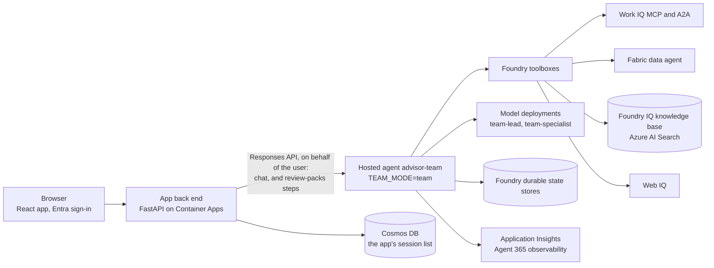
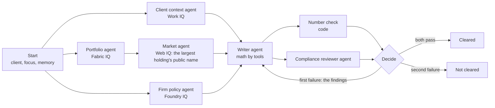
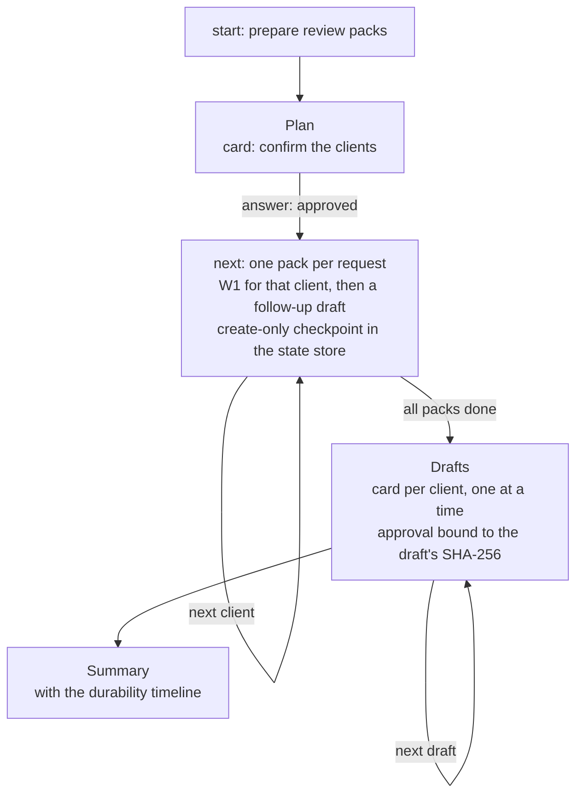
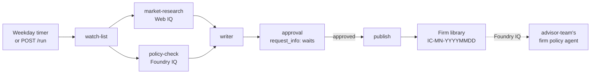

# Architecture

Investment Advisor is one container image that Microsoft Foundry hosts as one agent: a Microsoft Agent Framework
harness lead agent with four IQ specialist agents, a writer agent and a compliance reviewer agent, and three durable workflows. This page
describes the parts, how they coordinate, where state lives and how identity flows. How each piece maps to the Agent
Framework harness and its "claw" series is in [PATTERNS.md](PATTERNS.md).

> **Terms.** Investment Advisor is a multi-agent solution: a **lead agent** plans and delegates to four **specialist agents**, one per Microsoft IQ (the client context, portfolio, firm policy and market agents); the **writer agent** drafts the brief, and the **compliance reviewer agent** and a **number check** in code check it. *The advisor* is the person using the app.

> **Fictional data.** Every person, client, document, policy and figure in this sample is fictional.


Source: [architecture/investment-advisor-multi-agent.drawio](architecture/investment-advisor-multi-agent.drawio) (draw.io; an SVG
export is alongside). The sections below describe each part.

## Components



| Component | What it does | Runs on |
|---|---|---|
| The app | Sign-in (MSAL), sessions, streaming chat, the X-ray with the agents' lanes and the verdict card, source chips and page previews, approval cards, the consent banner, the **Review packs** panel | React in the browser, served by the app back end |
| The app back end | Validates the user's token, calls the agent on behalf of the user, reads cited Microsoft 365 items as the user, keeps the session list; sends the review-packs steps (`ui/packs.py`) | Azure Container Apps in a virtual network; Cosmos DB through a private endpoint |
| `advisor-team` | The lead agent and its specialist agents, the writer and reviewer agents, and the review-packs steps (`TEAM_MODE=team`) | Foundry hosted agent, Python 3.14 image from Azure Container Registry |
| Foundry toolboxes | One MCP endpoint per purpose, holding the connection and its credential: `team-workiq`, `team-workiq-chat`, `team-fabric`, `team-foundryiq`, `team-webiq`, `team-drafts`, `team-governance` | Foundry project |
| Foundry IQ | The fictional firm library: index `team-firm-library-index`, knowledge source `team-firm-library-ks`, knowledge base `team-firm-knowledge` | Azure AI Search (Basic, semantic ranker) |
| Fabric IQ | Workspace "Advisor Team", lakehouse `team_portfolio`, data agent "Team Portfolio Analyst" (fictional clients, prices, positions) | A Fabric capacity |
| Durable state | Memory, preferences, conversation history, meeting-pack and review-pack checkpoints, the hosting library's session and approval stores | Foundry durable state store (preview) |
| Observability | OpenTelemetry traces stamped `name:version`; Agent 365 observability export where the tenant has it | Application Insights |

## One image, two modes

`src/advisor_team/hosts/hosted.py` reads `TEAM_MODE`:

| Mode | Hosted agent | Host | What it serves |
|---|---|---|---|
| `team` (default) | `advisor-team` | `ResponsesHostServer(agent=create_team_agent, history_source="agent")` | The lead agent and its specialist agents, a fresh set per request; review-packs steps are answered in code ahead of the lead (`ReviewPacksGate`) |
| `solo` | not deployed by default | `ResponsesHostServer(agent=create_agent)` (`solo.py`) | The single agent with every tool: the fallback build |

`hosts/console.py` runs the same factory locally against the deployed resources (`python -m
advisor_team.hosts.console "question"`), with the consent check off; Foundry IQ and Web IQ questions work best there,
because Work IQ and Fabric need the hosted agent's per-user consent.

## The roles

`roles.py` defines each role; `team.py` builds them per request (`build_kit()`), and `create_team_agent()` wraps them in
the lead agent. A role's instructions are its own skill (`role-*`), so the optimizer can propose changes to them.

| Role (agent name) | Lane | IQ | Instructions | Domain skills | Tools | Model |
|---|---|---|---|---|---|---|
| Lead agent (`advisor-team`) | the top-level calls | all, through its specialist agents | `instructions.md` | `team-routing`, `client-meeting-prep`, `microsoft-iq-answer`, `what-changed`, `rebalancing-guard`, `position-cross-check`, `client-follow-up`, `durable-meeting-pack`, `durable-state`, `workiq-governance` | `ask_*`, background agents, `prepare_client_brief`, memory and preferences, `rebalancing_check`, `liquidity_check`, `to_eastern_time`, `demo_fault_switch`, `run_durable_meeting_pack`, `show_durable_state`, `show_state_store`, `probe_workiq_policy`, `draft_follow_up_email`, add-on tools | `team-lead` |
| Client context agent (`client_context`) | `client-context` | Work IQ | `role-client-context` | `work-iq-full-picture`, `meeting-recall`, `document-finder`, `workiq-vs-graph`, `work-iq-chat-and-agents`, `workiq-discovery` | the Work IQ MCP tools, `delegate_to_work_iq`, `list_client_documents`, `inspect_document`, `read_chart`, `to_eastern_time` | `team-specialist` |
| Portfolio agent (`portfolio`) | `portfolio` | Fabric IQ | `role-portfolio` | `portfolio-data` | `query_portfolio_data`, `to_eastern_time` | `team-specialist` |
| Firm policy agent (`firm_policy`) | `firm-policy` | Foundry IQ | `role-firm-policy` | `firm-knowledge` | `search_firm_knowledge` | `team-specialist` |
| Market agent (`market`) | `market` | Web IQ | `role-market` | `public-web-research` | `search_public_web`, `read_public_web_page` | `team-specialist` |
| Writer agent (`writer`) | `writer` | | `role-writer` | `rebalancing-guard` | `rebalancing_check`, `liquidity_check`, `to_eastern_time` | `team-lead` |
| Compliance reviewer agent (`compliance_reviewer`) | `reviewer` | Foundry IQ | `role-reviewer` | | `search_firm_knowledge` | `team-lead` |
| Number check | | | code (`workflows/brief.py`) | | | |

**The contract between agents** (`contracts.py`). Each specialist agent answers with structured output: a Pydantic
`SpecialistReport` passed as the agent's `response_format` (status `ok`, `unavailable` with a reason, or
`consent_required` with a link; a Markdown answer; `figures` exactly as the source gave them; `references` to the
Microsoft 365 items it cited). Code validates every result, including background agents' results, which come back as
text; a result that fails validation gets one repair attempt, then counts as `unavailable`. The reviewer agent returns a
`ReviewVerdict` (`cleared`, and `findings` with the sentence, the issue and the rule). The lead agent and the writer agent receive
reports as quoted evidence with a trust level: `firm` (Fabric figures, firm policy), `people` (mail, chats, files) or
`external` (the web), never as instructions.

## How the lead coordinates

The lead agent's `team-routing` skill picks one of three routes:

| | One specialist agent | Several specialist agents | A workflow |
|---|---|---|---|
| Used for | A question about one kind of fact | An open question that needs several kinds of fact (funding a cash need, a position across email and Fabric, what changed) | The client brief (W1); the review packs (W3) |
| How | `ask_client_context`, `ask_portfolio`, `ask_firm_policy`, `ask_market` | Background agents: `background_agents_start_task` once per specialist agent in one step, then `background_agents_wait_for_first_completion` and `background_agents_get_task_results` | `prepare_client_brief` (W1); W3's steps, which the app sends and code answers ahead of the lead agent |
| Who decides | The lead agent's model, which specialist agent | The lead agent's model, which specialist agents and what to ask each | The workflow, in code |
| Durability | None needed: one call | None: background tasks are asyncio tasks inside the request, and every task finishes or is cancelled before the turn ends | W1 runs inside the turn; W3 checkpoints every pack in the state store and resumes in a new session after a crash |

Every specialist agent runs inside the advisor's request (a direct call, an asyncio task or a workflow step), so the request
context, and with it the advisor's identity for Work IQ and Fabric, reaches it as it would reach a single agent. There
is no agent-to-agent identity hop.

## How the agents reach Work IQ

Work IQ is the one IQ the solution reaches in more than one way, each through a Foundry toolbox the calling agent holds,
always as the signed-in user and under the tenant's Work IQ policy. The diagram draws these paths; the decks' "How the
agents reach Work IQ" slide maps them to the demo.

| Path | Who calls | Toolbox | Protocol | What it does | Demo step |
|---|---|---|---|---|---|
| Work IQ's tools | Client context agent | `team-workiq` | MCP | `fetch` reads exact items through Microsoft Graph, `retrieve` searches by meaning with citations, and `ask` brings Copilot reasoning, even over a chart inside a PDF. The harness tools `list_client_documents`, `inspect_document` and `read_chart` use the same toolbox for raw results | 2.2, 3.2, 4.1 |
| Copilot agents | Client context agent | `team-workiq` | MCP | `list_agents` finds the Copilot agents the user can reach; `ask` with an agent ID puts the question to one | 5.3 |
| Work IQ's own agent | Client context agent | `team-workiq-chat` | A2A | `delegate_to_work_iq` hands a whole task to Work IQ Chat and gets one finished answer with its sources. Each message is a new A2A task, so a follow-up goes through `ask` | 2.2, 5.2 |
| The durable meeting pack (W2) | Lead agent | `team-workiq` | MCP | `retrieve` and `fetch`, one checkpointed phase at a time | 7.2, 7.4 |
| The one write | Lead agent | `team-drafts` | MCP | `draft_follow_up_email` calls `create_entity` only after the advisor approves the exact text; the draft lands in Outlook Drafts, and nothing is sent | 6.3 |
| The policy probe | Lead agent | `team-governance` | MCP | `probe_workiq_policy` reads the user's own mail and files, tries a directory lookup, and tries an update and a delete on a test item that doesn't exist; the tenant policy allows or denies each | 6.2 |

Two related paths aren't Work IQ calls. The lead agent's function-less copy of `team-workiq` is the consent check (see
[Identity and security](#identity-and-security)). The app's back end opens each cited source through Microsoft Graph
with the user's own permissions (demo step 1.4). The review packs (W3) ask for approval of each client's follow-up draft
too, but only show it (`DRAFT_MODE=preview`); they never call `create_entity`.

## W1: the client brief

`workflows/brief.py`, an Agent Framework workflow built with `WorkflowBuilder` and run by the `prepare_client_brief`
tool.



- **Fan-out:** client context, portfolio and firm policy start together. Market runs as soon as portfolio returns,
  because its task is built from the portfolio's figures labelled "largest position ticker" and "largest position
  company": the web query carries a public company name, never the client.
- **Fan-in:** the writer agent gets every report as quoted evidence, the advisor's memory and preferences, and its three
  tools. It writes Snapshot, Client documents, Since last discussion, Risks and conflicts, Questions to ask and
  Sources (always last), under 450 words plus Sources, each fact cited with its item, date and IQ.
- **Checks, in parallel:** the **number check** requires every material figure in the brief (money, percentages,
  decimals, numbers of 100 or more that aren't years) to appear in the evidence, the memory or the output of a writer agent tool,
  within a rounding tolerance; policy section references count as citations, not figures, and digits inside a link
  (such as `%E2%80%93`, an encoded dash) don't count at all. The **reviewer** fails
  advice wording (citing the firm's communication standard), a rule cited with a section that doesn't say what the
  draft claims, and a missing section. Code drops a reviewer agent finding that quotes nothing but the firm's standard tax
  disclosure ("… Please consult your tax adviser."): COM-310 §1 requires that text, so it can't be the reason a brief
  fails.
- **Decide:** both pass, the brief is **Cleared**; on the first failure the writer agent revises once with the findings,
  changing only what they point at; on
  the second, the brief is marked **Not cleared** and returned with the findings. The verdict goes into the activity
  record, and the app shows it as the verdict card. A brief cleared after a revision also carries `held_back`, the
  first draft's findings (the sentence, the issue and the rule), which the card lists under "Held back from the first
  draft"; a Not cleared card lists the final findings.
- A specialist agent that fails never stops the brief: its report becomes `unavailable`, and the brief says which IQ was not
  checked.

## W2: the durable meeting pack

`durable.py`, ported from the single agent. `run_durable_meeting_pack` researches one client in waves and follows
Foundry's guidance for long-running agents: each finished phase is an append-only checkpoint (a deterministic key, the
result and its SHA-256, written with create-only semantics) **before** the progress marker moves, and the marker moves
only with the ETag of the last read.

| Wave | Phases | Tools |
|---|---|---|
| 1 | Documents (OneDrive and SharePoint), meetings | Work IQ `retrieve` |
| 2 | Calendar, email | Work IQ `fetch` (Graph reads) |
| 3 | Portfolio, firm policy, market news (where deployed) | Fabric IQ, Foundry IQ, Web IQ |

Store layout per run, in `team-durable-runs`: `pack/<client>/<run>/run`, `…/progress`, `…/checkpoints/<n>-<phase>`,
`…/attempts/<n>` and `…/attempts/<n>-end`. The presenter's `process_crash` control stops the process with exit code 75
either between writes (after a wave's checkpoints, before the marker moves; the demo's choice) or in the middle of a
wave. The next call, from any session or process, restores what the marker passed, verifies and reuses the
checkpoints written just before the stop, runs only what's missing and returns a timeline of every attempt, process
and store write. An unfinished run older than 3 hours starts fresh. W2 resumes when asked; it is not re-entered by the
platform.

## W3: review packs

`workflows/review_packs.py`, on the same hosted agent, `advisor-team`: durable steps with checkpoints in the Foundry
state store, the pattern of W2. The app sends one step per request as a review-packs command; `ReviewPacksGate`, the
lead agent's outermost middleware, answers it in code without running the lead agent. Each step is one request, and no
request runs longer than one pack.



- **Clients:** `TEAM_REVIEW_CLIENTS`, else Michael Scott, Jan Levinson and Dwight Schrute; only the clients the request
  names, if it names any (up to six). The user can also send the list to use.
- **Packs:** each `next` request runs W1 for the next client with that request's own kit of agents (its own activity
  record), then asks the writer agent for a short follow-up email. A pack whose sources name no Microsoft 365 item about
  the client is **degraded** ("no Microsoft 365 history found for this client as the advisor"); in the fictional story,
  Jan Levinson and Dwight Schrute exist only in Fabric. Michael Scott's draft goes to
  `michael.scott@scott-family.example`; the others to `first.last@example.com`.
- **Drafts:** one card per client, one at a time; an approval applies only if it carries the SHA-256 of the exact
  recipient, subject and body shown. With `DRAFT_MODE=preview` (the default) the result is "previewed": shown, never
  sent or saved. W3 has no write path to the mailbox.
- **State,** in the user-isolated durable store (`team-durable-runs`): `packs/<run>/run` (the clients, the status, the
  pending card, the decisions and the timeline of steps and processes), `packs/<run>/pack-<n>` (one create-only
  checkpoint per finished pack, with its SHA-256; a checkpoint that fails its hash is prepared again) and
  `packs/<run>/crash` (the crash test's marker). Only the pending card can be answered, and only once.

### The crash test and recovery

Armed by the app's **Crash test** checkbox, "crash test" in the request, or the `packs_crash` presenter control. Before
the last pack (the third for three clients), the step writes the create-only marker `packs/<run>/crash`, so the test
fires once per run, records the stop in the run's timeline and ends the process (exit code 75, no cleanup); if the store
can't be reached, the test is skipped. Foundry keeps an interrupted conversation's turn in flight ("a service-backed
conversation already has an in-flight turn"), so the app sends the step again in a new conversation: a new session, so a
new process, and the same user's run in the state store.

```mermaid
sequenceDiagram
    participant App
    participant P1 as Process 1 (session A)
    participant P2 as Process 2 (session B)
    participant SS as State store
    App->>P1: start: plan, confirm the clients
    App->>P1: answer: approve
    App->>P1: next: pack 1
    P1->>SS: Pack 1, create-only checkpoint
    App->>P1: next: pack 2
    P1->>SS: Pack 2, create-only checkpoint
    App->>P1: next: pack 3
    P1->>SS: Create-only crash marker; the stop in the timeline
    P1--xP1: Exit code 75, no cleanup
    Note over App: The step fails: the app opens a new conversation
    App->>P2: next: pack 3, again
    P2->>SS: Load the run: packs 1 and 2 restored, not redone
    P2->>SS: Pack 3, checkpoint (the marker exists, so no second stop)
    P2-->>App: Draft cards, one at a time, then the summary with the durability timeline
```

In the live run on version 36, process 1 ran the plan and packs 1 and 2 and stopped before pack 3; the first retry, in a
new session 10 s later, restored them and ran pack 3: 308 s for the whole run.

### The wire protocol

`packs_protocol.py`. Every step goes to `advisor-team` through the Responses API with the user's token, in the run's own
conversation, streamed:

| Step | Input (one user message) | Answer |
|---|---|---|
| Start | `review-packs: {"op": "start", "request": "…", "crash_test": true}` | The run's view: `run`, `status` (`waiting`, `working`, `completed`, `failed`), the pending card (`clients`, or a draft with `to`, `subject`, `body` and `sha256`), `progress`, and the summary text when done |
| An answer | `review-packs: {"op": "answer", "run": "…", "call_id": "…", "answer": {"approve": true, "sha256": "…"}}` | The view |
| The next pack | `review-packs: {"op": "next", "run": "…"}` | Progress lines every 15 s while the pack runs, then the view |
| The view | `review-packs: {"op": "view", "run": "…"}` | The view |

The answer's last line is the view, as `review-packs-view: {json}`. The app's back end (`ui/packs.py`) sends a pack
step's answer to the browser with keep-alive whitespace while the pack runs, and turns a failed step into an
`interrupted` view with a new conversation for the retry; `scripts/review_packs.py` and the rehearsal speak the same
protocol.

## The activity record and the lanes

Specialist agents run inside a tool call of the lead agent, so their calls never appear as the lead agent's own output items.
`activity.py` makes them visible:

- `LaneRecorder`, a function middleware on every specialist agent, the writer agent and the reviewer agent, records each call with its
  lane, start time, duration, outcome, arguments and output, under the lead agent's call that started it.
- Workflow steps record their start and finish (`StepRecord`), and W1 records its verdict.
- `TeamActivityOutput`, an agent middleware on the lead agent, attaches the records not yet shown to the lead agent's next
  delegation result (`ask_*`, `prepare_client_brief`, the background-agent tools) in an envelope, `__team_activity__`,
  that only the app reads; the model and the history never see it.
- The app's back end unwraps it (whichever order it arrives in relative to the timing envelope) and draws one lane per
  role, the verdict card, and each nested call with its lane badge and the line naming its IQ and identity. The
  rehearsal runner reads the same records, so what it checks is what the presenter shows.
- Foundry stores only the lead agent's own calls, and the app loads their **Input / output** from it on demand. A
  nested call's arguments and output (as recorded, up to 4,000 characters each, with credentials and temporary sign-in
  URLs redacted) reach the browser once, in a separate `workiq.lane_payloads` event during the live run, and stay in
  its memory: the stored run keeps the X-ray lines, never these payloads.

## Identity and security

| Source | Identity | Consent |
|---|---|---|
| Work IQ (MCP and A2A) | The signed-in user, through the toolbox's OAuth connection, under the tenant's Work IQ policy | Once per user and agent |
| Fabric IQ | The signed-in user, with their Fabric permissions | Once per user and agent |
| Foundry IQ | The Foundry project's managed identity | None |
| Web IQ | An API key in the Foundry connection | None |
| Models, toolboxes, state stores | The hosted agent's Entra agent identity, with the caller's context | |

- **One platform agent.** The roles are code inside one hosted agent: one Entra agent identity, one sandbox, one Agent
  365 entry. Least privilege between them is enforced in code: each specialist agent gets only its own tools; only the market
  specialist agent reaches the internet, and only Web IQ; the reviewer agent can only read; only the lead agent holds the draft tool,
  which always needs approval.
- **The consent check.** With `TEAM_CONSENT_GATE` on (the default), the lead agent connects a function-less copy of the Work
  IQ toolbox at the start of every turn, so Work IQ's consent request reaches the app as the Authorize banner before any
  work starts.
- **The boundary guard** (`webiq.py`) blocks client and staff names (`WEB_BOUNDARY_TERMS`), email addresses, amounts,
  account-like numbers and links to the tenant's own Microsoft 365 or Azure hosts, at the hand-off to the market
  specialist agent (`WEB_TASK_BLOCKED`) and again at the tool (`WEB_QUERY_BLOCKED`).
- **The one write.** `draft_follow_up_email` is `approval_mode="always_require"`: the app shows an approval card, and only
  then does Work IQ `create_entity` save a draft in Outlook Drafts, as the advisor; nothing is sent, and the tenant
  policy denies updates and deletes. The policy probe uses a separate toolbox with `fetch`, `update_entity` and
  `delete_entity` against an item that doesn't exist.
- **No shell, no local files, no built-in web search** in the harness: file memory and web search are off.
- **Guardrails, in real time:** each model deployment uses this deployment's guardrail policy. Terraform sets its content
  filters on prompts and completions. In the demo tenant the policies also carry Microsoft Defender for AI's checks
  (prompts, completions, runs and tool calls) and Prompt Shields' indirect-attack detection: blocking on the prompts of
  the lead and judge deployments, detect-only on the specialist deployment and on tool results. These act as each
  request comes in; the hourly evaluation ([QUALITY-LOOP.md](QUALITY-LOOP.md)) only audits the traces afterwards.
- **Purview data security** (`purview.py`; `enable_purview`, on in the demo tenant). Agent Framework's Purview middleware
  sends each prompt and each final answer of the lead agent's turns to Microsoft Purview (`processContent`): the agent's
  identity calls Graph, and the activity is the signed-in user's (their object ID, from the request). A Purview DLP policy
  scoped to the agent's Entra app (`scripts/Set-PurviewDlpForAgent.ps1`: a prompt with a U.S. Social Security number is
  blocked, with an alert) stops a prompt before any agent sees it; `PurviewGate` answers it with Purview's block message, so
  the run completes instead of failing. With Purview on, the answer is released when complete rather than streamed.
- **Every Work IQ call, in the logs your security team already has.** Each call to the agents is an Agent 365 audit record
  (`InvokeAgent`); each Microsoft Graph request Work IQ makes is in the Graph activity logs, under the user's object ID; the
  Purview audit records what Work IQ read (`CopilotInteraction`, with the files, emails and meetings, and jailbreak and
  cross-prompt-injection flags; `MailItemsAccessed`, `FileAccessed`), the hosted agent's own prompts and answers
  (`ConnectedAIAppInteraction`), and each DLP match (`DLPRuleMatch`) and alert. Microsoft Defender advanced hunting reads
  them all (`CloudAppEvents`, `MicrosoftGraphActivityLogs`, `AgentsInfo`); `scripts/Get-WorkIqAuditTrail.ps1` lines up
  the agents' Work IQ calls from the traces with those logs, for one user and a time window. The queries are in
  [the walkthrough's Appendix A](DEMO-WALKTHROUGH.md#appendix-a-defender-advanced-hunting-queries).
- **The loop, closed end to end.** Policy (the Work IQ tenant policy in Agent 365, the Purview DLP policy, the hosted
  agent's Entra agent ID) → enforcement at run time (as the user, with their permissions; the DLP block; approval for every
  draft) → evidence (Defender advanced hunting, Purview Audit, DLP alerts, under the user's name) → improvement (the same
  traces feed Insights, the evaluations and the optimizer; a winning candidate is promoted as a new version of the same
  hosted agent, so the same identity, policies and logs apply to it).
- **Network:** the app runs in a virtual network and reaches Cosmos DB through a private endpoint; the Foundry account
  keeps a public, Entra-only endpoint because OAuth tool connections need it.

## State

Every store is a Foundry durable state store with **user isolation**: the platform resolves the caller from the
request, so one advisor never reads another's items.

| Store | Holds | Written by |
|---|---|---|
| `team-client-memory` | Discussion baselines, the last brief and the presenter's demo switches | The agents |
| `team-conversations` | Each conversation's messages, so any process can continue it | The agents (history provider) |
| `team-durable-runs` | W2 runs (progress markers, checkpoints, attempts) and W3 runs (the run, a checkpoint per pack, the crash test's marker) | The agents |
| `team-preferences` | How the advisor wants briefs written (format only, never facts) | The agents |
| Agent sessions and function approvals | The serialized agent session; tool calls waiting for approval | The Agent Framework hosting library |

The prefix comes from `ADVISOR_STORE_PREFIX` (`team`); a candidate agent gets its own prefix, so it never shares state
with the live agent. The app's session list lives in Cosmos DB.

## Models

| Deployment | Default model | Used by |
|---|---|---|
| `team-lead` | `gpt-5.6-luna`, DataZone Standard | The lead agent, the writer agent, the reviewer agent (and the add-on agents) |
| `team-specialist` | `gpt-5.6-luna`, DataZone Standard; in its own account and region when `specialist_location` is set, for quota | The four specialist agents, which run in parallel |
| `team-judge` | `gpt-5.5`, Global Standard | Evaluation judges, Insights and the optimizer |

**The stall guard** (`stall.py`): a non-streaming model call that hasn't answered within `TEAM_MODEL_STALL_SECONDS`
(120 s by default) is abandoned and sent once more. It wraps the specialist agents, the writer agent and the reviewer agent; the lead agent
streams to the app, and a half-streamed answer can't be resent.

## Observability

OpenTelemetry traces go to the Application Insights connected to the Foundry account, stamped with the agent's
`name:version` (so Foundry groups evidence per release). One trace covers a turn: the lead agent, the specialist agents' runs
and every tool call. Where the tenant has Agent 365 observability, the agent exports to it as its own Entra agent
identity. The activity record (above) is the app's and the rehearsal's view of the same calls.

## Configuration

Set by Terraform in the agent's environment unless noted; override others with `agent_extra_environment`.

| Variable | Default | Meaning |
|---|---|---|
| `TEAM_MODE` | `team` | `team` or `solo` |
| `TEAM_LEAD_DEPLOYMENT`, `TEAM_SPECIALIST_DEPLOYMENT`, `TEAM_JUDGE_DEPLOYMENT` | `team-lead`, `team-specialist`, `team-judge` | Model deployments |
| `TEAM_SPECIALIST_ENDPOINT` | empty | The endpoint of the specialist agents' model account, when they have their own |
| `TEAM_CONSENT_GATE` | on | The consent check at the start of each turn |
| `TEAM_PLAN_MODE`, `TEAM_TODOS` | on | The harness's plan and execute modes (execute by default) and to-dos |
| `TEAM_MODEL_STALL_SECONDS` | 120 | The stall guard's bound |
| `TEAM_REVIEW_CLIENTS` | the story's three | W3's client list (comma-separated) |
| `DRAFT_MODE` | `preview` | W3 drafts: shown, never saved |
| `ADVISOR_STORE_PREFIX` | `team` | State store names |
| `WEB_BOUNDARY_TERMS` | from `web_boundary_terms` | Names that never leave the boundary |
| `DEMO_FAULTS` | empty | Faults the agent always simulates (for example `fabric`) |
| `ADVISOR_CLOCK_NOT_BEFORE` | empty | A clock floor for rehearsing before the story's Monday (ISO 8601) |
| `OPTIMIZATION_LOCAL_DIR` | `/app/.agent_configs/team` | The optimizer-ready configuration the agent loads |
| `ENABLE_SENSITIVE_DATA` | from `agent_capture_content` | Prompts and tool payloads in traces |
| `TEAM_WHAT_IF`, `TEAM_COMMITTEE`, `TEAM_PURVIEW` | on, off, off | The add-ons below |

## Optional add-ons

Each is a Terraform toggle. Microsoft Purview is part of the demo (segment 6); the others aren't in the demo script.

| Add-on | Toggle (default) | What it adds |
|---|---|---|
| What-if analyst | `enable_what_if` (on) | `run_what_if`: the portfolio agent supplies Fabric IQ figures; a what-if analyst writes and runs Python in a Monty sandbox (CodeAct: no network or file access, time and memory limits) and labels assumptions. Its calls show in a "What-if analyst" lane |
| Investment committee | `enable_committee` (off; experimental) | `convene_investment_committee`: a group chat of the portfolio, firm-policy and market members and a risk officer, with the speaking order in code; the chair's minutes are refused if they carry a rule code or figure no member said. Not repeatable enough for customer demos |
| Microsoft Purview | `enable_purview` (off; on for the demo) | Agent Framework's Purview middleware on the lead agent's turns: each prompt and final answer is checked against the tenant's Purview policies as the signed-in user's activity, and a blocked prompt gets Purview's block message (`PurviewGate`). The answer is released when complete rather than streamed. Terraform grants the agent identity three Microsoft Graph application roles (ProtectionScopes.Compute.All, Content.Process.All, ContentActivity.Write); `scripts/Set-PurviewDlpForAgent.ps1` creates the demo's DLP policy. Needs Purview pay-as-you-go billing for AI apps |
| Morning note | `enable_morning_note` (off) | The same workflow model on a second runtime: a durable workflow on Azure Functions and the Durable Task Scheduler that writes the firm's morning note, waits for the head of research's approval and publishes it to the firm library, where the firm-policy specialist agent cites it. See [the morning note](#the-morning-note-o1) |

### The morning note (O1)



- **Runtime.** `functions/morning_note/function_app.py` builds an Agent Framework workflow (`WorkflowBuilder`, six
  executors, a fan-out and a fan-in) and hosts it with `AgentFunctionApp(workflow=…)` from
  `agent-framework-azurefunctions`, on a Flex Consumption Function app. Each executor runs as a durable activity
  (`dafx-morning-note-<executor>`), and the Durable Task Scheduler keeps the run's history: a restart resumes after
  the last finished step. The approval is `request_info`: the run waits on the scheduler, using no compute, until the
  head of research answers.
- **HTTP** (function key): `POST /api/workflow/morning-note/run` with `{"tickers": [...], "date": "YYYY-MM-DD"}` (both
  optional), `GET …/status/{instanceId}` (the pending approval, with the exact draft and its `respondUrl`) and
  `POST …/respond/{instanceId}/{requestId}` with `{"approve": true, "reviewer": "…"}`; only `true` (or the string
  `"true"`, as an Adaptive Card toggle sends it) publishes, and any other answer leaves the note unpublished.
  `scripts/Invoke-MorningNote.ps1`
  drives all three. A timer starts a note on weekday mornings (`morning_note_schedule`; empty for on demand only).
- **Identity.** The Function app's own user-assigned managed identity, never a user: Foundry User on the project (the
  `team-lead` model and the `team-webiq` and `team-foundryiq` toolboxes), Search Index Data Contributor on
  `team-firm-library-index` only, and Durable Task Data Contributor on the scheduler. It handles public news and firm
  policy only, and its instructions forbid client names, accounts and positions.
- **The note.** Under 300 words, one section per ticker. The approval request carries the exact draft as plain JSON;
  a waiting run's status is capped at 16 KB, so a draft that still doesn't fit after one rewrite stops the run instead
  of being cut. Earlier morning notes are never cited as policy. Publishing writes the approved text in full, one
  library section per ticker (`IC-MN-<date>-<n>`, without vectors; a ticker's later headings join its section), and
  removes sections an earlier note of the same day had beyond them.
- **Network.** The storage account allows no public access and no shared keys, so the app is integrated with its own
  virtual network and reaches blob, queue and table storage through private endpoints, with identity-based connections
  only.

## What this sample doesn't claim

- W2 resumes when asked; W3 resumes when the app sends the failed step again, in a new session. Neither is re-entered by
  the platform on its own.
- Background-agent tasks aren't durable: they live inside one request.
- Steps run at least once: a step that was running at a crash runs again (a read repeats harmlessly; a model call may
  word things differently), and approvals are bound to the exact text for that reason.
- The specialist agents share one agent identity; separate identities per role would need separate hosted agents over A2A.
- Purview checks the lead agent's turns (the user's prompt and the final answer), not the messages between agents, nor
  the review-packs steps, which are the app's commands answered in code. Purview stops the agents from seeing a blocked
  prompt; the Responses conversation the app sends it to still records the request.
- The Work IQ tenant policy is tenant-wide; this repository never changes it.
