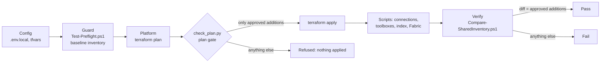

# Isolation: deploying without touching what exists

The deployment can stand alone, or sit next to resources that other workloads use. Either way, it never modifies,
renames or deletes anything it didn't create. This page explains the two levels of isolation, the names the solution
uses, the guardrails that act before a change, the isolated local profile, and what logical isolation can't cover.

> **Terms.** Investment Advisor is a multi-agent solution: a **lead agent** plans and delegates to four **specialist agents**, one per Microsoft IQ (the client context, portfolio, firm policy and market agents); the **writer agent** drafts the brief, and the **compliance reviewer agent** and a **number check** in code check it. *The advisor* is the person using the app.

## Two levels

| | Complete isolation | Logical isolation |
|---|---|---|
| When | `EXISTING_*` are empty (the default) | You pass `-ExistingFoundryAccountId`, `-ExistingSearchServiceId` and/or `-ExistingFabricCapacityId` to the deploy script. The Config step records them in `.env.local` as `EXISTING_*`, where the guardrails read them, so later runs can leave them out |
| What's created | Everything, in a new resource group: the Foundry account and its models, Azure AI Search, the Fabric capacity, the registry, Cosmos DB, the app, Application Insights | Everything that isn't shared, in a new resource group; inside each shared resource, only additions under this solution's own names |
| What's shared | Only the tenant (Entra ID, the Work IQ tenant policy, Agent 365, Defender) | The tenant, plus the shared resources' limits and load |
| Removal | `Remove-AdvisorTeam.ps1` destroys it all | `Remove-AdvisorTeam.ps1` keeps the shared resources and removes this solution's additions from them (see below) |

For a hard guarantee, use complete isolation, or a dedicated subscription or tenant.

## The names this solution uses

| Kind | Name |
|---|---|
| Resource group | Your `-ResourceGroup`, for everything that isn't shared |
| Foundry project | `proj-advteam-<suffix>` in an existing account (or the project of a new account) |
| Hosted agents | `advisor-team`; `advisor-team-candidate` for the quality loop; optionally `advisor-team-solo` |
| Model deployments | `team-lead`, `team-specialist`, `team-judge` (a new account also gets `text-embedding-3-large`) |
| Guardrail policy | `team-guardrail-<suffix>` in an existing account |
| Toolboxes | `team-workiq`, `team-workiq-chat`, `team-fabric`, `team-foundryiq`, `team-webiq`, `team-drafts`, `team-governance` |
| Connections | Suffixed with this deployment's suffix in an existing account (connection names are unique per account) |
| Azure AI Search | `team-firm-library-index`, `team-firm-library-ks`, `team-firm-knowledge` |
| Fabric | Workspace "Advisor Team", lakehouse `team_portfolio`, data agent "Team Portfolio Analyst" |
| Entra apps | Names starting with `advisor-team`: the toolbox client and the app's API and browser apps (`advisor-team-<suffix>-…`), and the Fabric IQ connection's app |
| State stores | `team-client-memory`, `team-conversations`, `team-durable-runs`, `team-preferences` (a candidate agent gets its own prefix) |
| Morning note (add-on) | In the resource group: `func-mn-<suffix>` on the plan `asp-mn-<suffix>`, `dts-advteam-<suffix>` with the task hub `advisor-team`, `id-morning-note-<suffix>`, `stmn<suffix><hash>` with the private endpoints `pe-mn-blob-<suffix>`, `pe-mn-queue-<suffix>` and `pe-mn-table-<suffix>`, `vnet-mn-<suffix>`. In Azure AI Search: documents `IC-MN-<date>-<n>` in this solution's own `team-firm-library-index`, written by the app's identity, which holds Search Index Data Contributor on that index only |

`<suffix>` is `-NameSuffix`, or the profile name (`TEAM_NAME_SUFFIX` in `.env.local`).

## The guardrails

They act **before** a change, not only after.



1. **Preflight** (`scripts/Test-Preflight.ps1`, the Guard step). Read-only. Checks the shared Foundry account (project,
   deployments, guardrail policy), the shared Search service (index, knowledge source, knowledge base), the shared
   capacity's workspaces and the tenant's app registrations, and fails with the exact item if a planned name already
   exists and isn't recorded in this solution's own Terraform state.
2. **Baseline inventory** (`scripts/Get-SharedInventory.ps1`). A read-only snapshot, taken the first time the Guard step
   runs with shared resources: every resource in the shared resource groups; the shared account's projects, model
   deployments and connections (no secrets); role assignments; every existing project's agents (all versions) and
   toolboxes; Search indexes, knowledge sources and knowledge bases; Fabric workspaces and their items; Entra
   applications, service principals and delegated grants. Only GET requests.
3. **The plan gate** (`scripts/check_plan.py`, wired into `scripts/Invoke-TerraformApply.ps1`). Every Terraform plan is
   exported and checked before apply. Inside a shared scope (the shared resources and their resource groups, from
   `EXISTING_*` in `.env.local` and from the plan's own `existing_*` variables), a
   plan may only **create** items whose names match `scripts/approved-additions.json`, plus role assignments, which are
   listed for review. Updates and deletes there are refused unless this state created the item, and resource actions
   and update-only resources on shared items are always refused. A refused plan applies nothing. Separately, any plan
   that changes or destroys existing resources stops unless the step allows changes.
4. **The approved list** (`scripts/approved-additions.json`): the name patterns (`proj-advteam-`, `team-`,
   `advisor-team`, `Advisor Team`, `Team Portfolio`, `team_portfolio`, and the agent identity blueprints Foundry creates
   for this project) and resource ID patterns (this project, the `team-*` deployments, this deployment's resource group)
   that may be added. Role assignments and permission grants are approved only for this deployment's own principals,
   which the Verify step writes from Terraform outputs to `<work>\principals.json`.
5. **The inventory diff** (`scripts/Compare-SharedInventory.ps1`, the Verify step). A fresh snapshot is compared with
   the baseline. A **violation** is an existing item removed or changed, or an addition that isn't approved; the script
   exits with 1. An addition nothing here created but the platform may add by itself (such as a first-party service
   principal) is listed for **review**, not failed.
6. **Tenant-wide items.** The Work IQ service principal is created only in a tenant that has none
   (`create_workiq_service_principal`), never adopted, and never deleted on removal. The Work IQ tenant policy is never
   changed by this repository.

Run the checks yourself at any time:

```powershell
.\scripts\Test-Preflight.ps1
.\scripts\Get-SharedInventory.ps1 -Label baseline     # once, before the first deployment
.\scripts\Compare-SharedInventory.ps1                  # after any change: exit code 1 on a violation
```

## The isolated profile

`scripts/Use-IsolatedAzure.ps1` points Azure CLI, Terraform and the Python environment at a private folder per
deployment, for the current PowerShell process only. Every script dot-sources it; `scripts/Connect-IsolatedAzure.ps1`
signs the profile in by device code (and signs out first, so a stale Microsoft Graph token never lingers).

| Folder under `%LOCALAPPDATA%\advisor-team\<TEAM_PROFILE>` | Holds | Variable |
|---|---|---|
| `azure` | The Azure CLI sign-in and token cache | `AZURE_CONFIG_DIR` |
| `terraform` | The Terraform state and plugins | `TEAM_TF_STATE`, `TF_DATA_DIR` |
| `venv` | The Python environment for the scripts and tests | `UV_PROJECT_ENVIRONMENT` |
| `bin` | Terraform (installed here if missing), first on `PATH` | |
| `work` | Plans, logs, inventories, rehearsal reports, review-pack transcripts | `TEAM_WORK_DIR` |
| `msal`, `docker`, `azd`, `browser` | Other caches | |

Your default `%USERPROFILE%\.azure` is never read or written, so other terminals, editors and projects keep their own
sign-ins. `.env.local` (git-ignored) holds the profile's settings; `.env.example` explains them. Settings named `TEAM_*`,
`EXISTING_*`, `DEMO_*`, `WEB_*`, `WEBIQ_*`, `STORY_*`, `DRAFT_*`, `FABRIC_*`, `FOUNDRY_*` and `ADVISOR_*` are exported
to the process.

## State isolation

- Every durable state store is **user-isolated**: the platform resolves the caller from the request, so one advisor
  never sees another's memory, preferences, history or checkpoints.
- Store names carry a prefix (`ADVISOR_STORE_PREFIX`, `team`); a candidate agent gets its own prefix, so evaluating or
  optimizing a candidate never touches the live agent's state.
- The chat turns and the review-packs steps of the live agent share the `team-*` stores per user on purpose: the
  presenter controls (for example a specialist agent outage or the review-packs crash test) and the review-packs runs
  live there, so a new session or process finds them.

## What logical isolation doesn't cover

- **Quota.** New model deployments draw on the subscription's regional (or DataZone) quota.
- **Load.** A shared Search service's replicas and a shared Fabric capacity's compute serve every workload on them.
  Don't run rehearsals, evaluations or the optimizer during another workload's demo.
- **Capacity state.** `Set-FabricCapacityState.ps1` and `Start-DemoPrewarm.ps1 -IncludeFabric` pause or resume the
  capacity they're pointed at, and removal may resume a paused capacity to delete the workspace. With a shared
  capacity, agree with its owner first, and run the prewarm without `-IncludeFabric`.
- **The tenant.** Entra ID, Agent 365 and Defender list every agent, and the Work IQ tenant policy governs all of them.
- **The mailbox.** An approved 6.3 draft lands in the signed-in advisor's Drafts folder, which another demo in the same
  tenant may read. The review packs never write to the mailbox. Never run the Content step in a tenant another demo
  uses: it writes the story's mail and files.
- **Removal leftovers.** In an existing Search service, the `team-firm-*` index items stay after removal; delete them
  by hand.
- **People.** The guardrails stop scripts, not someone clicking in a portal.
