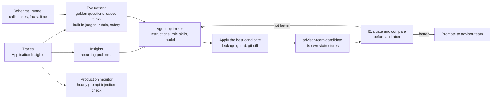

# The quality loop: traces, evaluations, Insights and the optimizer

An agent that reads live, messy data drifts: a new kind of email, a changed document, a new model version. The quality
loop finds what goes wrong in real traffic, measures it, proposes a fix, proves the fix on a candidate agent, and only
then releases it. Everything runs in Microsoft Foundry, on the agents' own traces, and every judge runs on `team-judge`,
never on the agents' own model deployments.

> **Terms.** Investment Advisor is a multi-agent solution: a **lead agent** plans and delegates to four **specialist agents**, one per Microsoft IQ (the client context, portfolio, firm policy and market agents); the **writer agent** drafts the brief, and the **compliance reviewer agent** and a **number check** in code check it. *The advisor* is the person using the app.



## The parts

| Part | What it does here | How to run it |
|---|---|---|
| **Traces** | Every turn: the lead agent's run, the specialist agents' runs, every tool call and model call, stamped `advisor-team:<version>` | Automatic (OpenTelemetry to Application Insights) |
| **The rehearsal runner** | Sends every prompt in `demo/expectations.yaml` and checks the calls, the lanes (which specialist agents ran, and that a one-IQ question ran one lane), the facts and the time budget | `scripts/rehearse.py` ([runbook](DEMO-RUNBOOK.md#rehearse)) |
| **Source check** | Opens every Microsoft 365 item a rehearsal's answers cite (the app's source chips) through Work IQ, as the advisor, and checks it is the item the title names; writes `sources.md` in the run folder | `scripts/check_sources.py` after a rehearsal |
| **Rubric evaluator** | "Advisor team quality (rubric)" (`advisor-team-quality`), generated by Foundry from the agent and a description of a good answer: weighted dimensions such as grounding, exact figures, conflicts and boundary safety | `.\evals\Invoke-FoundryQuality.ps1 rubric` (the Quality step runs it) |
| **Golden questions** | The cases in `evals/hosted-optimizer-cases.json` sent to the hosted agent; each answer scored by built-in judges that read the answer (intent resolution, coherence, fluency), the rubric and the indirect-attack judge. Shows on the agent's Evaluation tab | `.\evals\Invoke-FoundryQuality.ps1 target -Safety` |
| **Production traces** | The agents' real traffic checked, step by step, for prompt injection hidden in what it read; nothing is replayed | `.\evals\Invoke-FoundryQuality.ps1 traces -Hours 24 -Safety` |
| **Recurring evaluation** | The production-traces check on a schedule: the production monitor for a hosted agent | `.\evals\Invoke-FoundryQuality.ps1 schedule -EveryHours 1 -Limit 10 -Safety` |
| **Saved-turn evaluation** | Saved turns (prompt, tool calls and results, answer) scored with the same judges plus task adherence and tool use, for before-and-after comparisons | `.\evals\Invoke-FoundryQuality.ps1 dataset -Safety -Label <label>` and `compare` |
| **Insights** | Scans recent traces with a judge model and groups failures into findings, each with evidence traces and a suggested fix; a monitor scans daily | `.\evals\Invoke-FoundryQuality.ps1 insights -Hours 24` |
| **Agent optimizer** | Proposes and scores candidates for the agents' instructions, skills (including the role skills) and model on the golden questions; or, with no side effects, for the brief-writer prompt agent on `evals/optimizer-cases.json` | `optimize-hosted -Agent advisor-team-candidate`; `optimize` (the Quality step runs it once) |
| **Candidate agent** | `advisor-team-candidate`: the same toolboxes, its own memory and checkpoint stores, so a candidate never touches the live agent's users or state | `.\scripts\Publish-CandidateAgent.ps1` |

`Invoke-FoundryQuality.ps1` runs as the isolated profile's signed-in identity, installs the Foundry SDK into the
profile once, and keeps evaluator, evaluation and monitor IDs in the work folder, never in the repository. Without
`-Agent` it targets the Terraform-managed agent, `advisor-team`.

## Evaluate in production

For a hosted agent, the recurring evaluation is the production monitor. It shows under **Evaluations** > **Recurring
configs** as `advisor-team-production-traces`:

```powershell
# Every hour, check up to 10 of that hour's production traces, every agent step, for prompt injection.
.\evals\Invoke-FoundryQuality.ps1 schedule -EveryHours 1 -Limit 10 -Safety
# Pause it with -Disable, or remove it with -Delete.
```

It runs as the Foundry project's managed identity, reads what already happened, and adds judge calls but never calls
the agents. Continuous evaluation rules (`continuous`) score each completed response for prompt agents; Foundry rejects
hosted agents, and the command says so.

**An audit after the fact, not the protection.** Prompt injection is handled as each request comes in: by the
deterministic controls (typed reports read as quoted evidence, each role's own tools, approval for the one write) and by
the guardrail policies on the model deployments (Prompt Shields' indirect-attack detection;
[ARCHITECTURE.md](ARCHITECTURE.md#identity-and-security)). The hourly evaluation measures what still reached the
agents' steps, for a person to review.

**Why only prompt injection on production traces.** Foundry turns a hosted agent's traces into one item per agent
step, not per answer: a step that calls tools ends in a progress note, and the step that answers has no tool calls. A
judge of whole answers would read each step as unsupported. The prompt-injection judge is meant for single steps.
Answer quality is measured on whole answers: the golden questions on every release, and saved turns before and after
a change.

**Why the golden questions don't judge groundedness.** An agent-target evaluation gives a judge the hosted agent's
tool calls and results only as `sample.output_items`, which also carry the model's reasoning steps, and the built-in
judges error on those (checked again on 2026-10-22). Given the answer text alone, groundedness and task completion
read every sourced figure as made up: on 2026-10-22 they failed five of the six golden answers with "no tool results
support these details". So the golden questions use the judges that read an answer (intent resolution, coherence,
fluency, the rubric and the prompt-injection judge), and the judges that check an answer against its sources
(groundedness, task adherence, task completion, tool use) run on saved turns, whose items carry the lead agent's tool calls
and the specialist agents' reports.

**The optimizer judges with the rubric.** The optimizer hands its judges the hosted agent's output items, reasoning steps
included. The built-in task adherence judge errored on every case (2026-10-22), and an errored judge counts as 0; the
rubric evaluator reads them. So `optimize-hosted` scores candidates with the rubric alone (task adherence only when no
rubric exists).

**Judges never use the agents' deployments.** `Invoke-FoundryQuality.ps1` passes `team-judge` as the judge (and as the
optimizer's model) for every evaluation and for Insights: a judge scoring long traces on the agents' own deployment
could use up its rate limit and make the agents' answers fail.

**Run what calls the agents when nobody is using it.** The golden questions and the optimizer send questions to the
agents themselves, on their own deployments, as you: Work IQ reads your Microsoft 365 data with your consent. Run them
outside demos and working hours, the optimizer with `-Concurrency 1`.

## Why the agents are optimizer-ready

The agents' instructions, skills and model are data, not code: [`.agent_configs/team/baseline`](../.agent_configs/team/baseline)
holds `instructions.md` (the lead agent), `skills/<name>/SKILL.md` and `metadata.yaml` (the model, `team-lead`). Each role's
own instructions are a skill too (`role-client-context`, `role-portfolio`, `role-firm-policy`, `role-market`,
`role-writer`, `role-reviewer`), so the optimizer can propose changes to a specialist agent the same way as to the lead agent. At
startup, `src/advisor_team/agent_config.py` calls `load_config()` from `azure-ai-agentserver-optimization`:

- in normal runs it loads the baseline (`OPTIMIZATION_LOCAL_DIR`, `.agent_configs/team` in the image);
- when the optimizer runs a candidate, the platform supplies the candidate's instructions, skills and model, so the
  same image runs every candidate;
- `apply` writes the winning candidate back into the baseline, where you review it with `git diff` like any change.

The single-agent build has its own baseline in `.agent_configs/solo/baseline`.

## The leakage guard

The optimizer scores candidates on a small set of cases, and a candidate can win by memorizing them: hard-coding the
date, copying figures from the expected answers, or greeting the advisor by name. `apply` checks every candidate before
it writes anything and refuses one that:

- states an absolute date ("Today is …");
- contains a figure, date or time from a case's ground truth (`evals/hosted-optimizer-cases.json`,
  `evals/optimizer-cases.json`) that the baseline doesn't already contain;
- names the advisor or the analyst when the baseline doesn't;
- quotes a test question word for word (any run of eight words from a case's question that the baseline doesn't
  have): a "special handling" section for the exact cases it is scored on.

It prints why. Take the candidate's general improvements by hand, or, after review, apply it anyway with
`-AllowLeaks`. Either way, a candidate reaches users only after it wins on `advisor-team-candidate`.

## Run the loop

Prerequisites: a deployment ([DEPLOYMENT.md](DEPLOYMENT.md)), the story content, and Work IQ consent for the
candidate agent (consent is stored per agent: the first call prints the link).

```powershell
# 1. Release a candidate next to the live team (same code, its own state stores), consent once, seed its memory.
.\scripts\Publish-CandidateAgent.ps1                      # advisor-team-candidate
.\scripts\Invoke-Agent.ps1 -AgentName advisor-team-candidate -Prompt "Save Friday's Q4 portfolio review with Michael Scott as our last discussion."

# 2. Measure: rehearse the side-effect-free demo prompts on the candidate, score them, scan its traces.
.\evals\Invoke-QualityLoop.ps1 -Stage Evaluate, Insights -Label before

# 3. Improve: the optimizer proposes instructions, skills and model; see the candidates and their scores.
.\evals\Invoke-QualityLoop.ps1 -Stage Optimize
.\evals\Invoke-QualityLoop.ps1 -Stage Status

# 4. Apply the best candidate, review the diff, release it as the candidate agent.
.\evals\Invoke-QualityLoop.ps1 -Stage Apply
git diff -- .agent_configs
.\scripts\Publish-CandidateAgent.ps1                      # add -Model <deployment> if the candidate changed the model

# 5. Verify: the same evaluation, compared with step 2; and the rehearsal runner against the candidate.
.\evals\Invoke-QualityLoop.ps1 -Stage Evaluate, Compare -Label after -Before before
& $py scripts\rehearse.py --agent advisor-team-candidate --segments prep fouriqs eachiq firm web --have workiq-consent fabric webiq

# 6. Promote when it wins: publish the same code to the live agent (advisor-team); otherwise git checkout -- .agent_configs.
.\scripts\Publish-AgentImage.ps1
```

`$py` is the isolated profile's Python ([runbook](DEMO-RUNBOOK.md)). The candidate's name is `ADVISOR_CANDIDATE_AGENT`
from `.env.local`, else `advisor-team-candidate`. `Invoke-QualityLoop.ps1` also has `Release` and `Promote` stages that
wrap the two publishing scripts; the commands above call the scripts directly. `evals\Invoke-FoundryQuality.ps1` runs
each command on its own (`dataset`, `insights`, `optimize-hosted`, `optimizer`, `apply`, `compare`).

## Measuring each role

Several agents are easier to improve than one large prompt, because each role can be measured on its own:

- **Routing and lanes.** The rehearsal runner checks, per step, which lanes ran (`lanes`), that a one-IQ question ran
  only its own lane (`only_lanes`), which calls must and must not happen (`calls`, `never`), and that no client detail
  reached the market agent (`no_client_detail_to_web`). Its report has a **Lanes** column with each lane's call
  count.
- **The reviewer agent.** The reviewer test (demo step 9.2) seeds one advice sentence into a brief's first draft; the step
  passes only if the brief is revised (`expect_revision`).
- **Degradation.** The test with a specialist agent offline (9.3) passes only if the answer says the IQ wasn't checked.
- **Traces.** Each specialist agent's run is its own span tree in the trace: its tool calls, durations and tokens.

A Foundry evaluation per role, with its own evaluator, isn't part of this build yet; Foundry's evaluations target the
whole hosted agent.

## Model selection

The optimizer compares the agents' model with the deployments in Terraform's `model_search_deployments` (created only in
a Foundry account the deployment creates). Add one in `terraform/terraform.tfvars`, then rerun the Platform step:

```hcl
model_search_deployments = { "gpt-6-sol" = { version = "<model version>", capacity = 150 } }
```

In an existing (shared) Foundry account there are none, so the optimizer tunes the instructions and skills and keeps
the model: it never runs candidates on a deployment another workload owns, whose quota it would use.

A model change lands in `metadata.yaml`. Before promoting it, point the live agent's deployment at the same model
(`team_lead_model` and `team_lead_model_version` in `terraform.tfvars`), so the live definition matches.

## Read the results

- **Compare** prints each judge's pass rate and the rubric mean before and after. A candidate should win on the rubric
  and on task adherence without losing groundedness or the indirect-attack judge.
- **Status** lists each candidate's score per case. Look at the worst case, not just the average.
- **Insights** findings should disappear from later scans; open their evidence traces from the agent's Insights page.
- **The rehearsal** must stay green: the same calls, lanes, facts and budgets.
- **Cost:** the optimizer prints an estimate before it starts; the judges use `team-judge`.
- **Judges have blind spots.** Read the reasons, not only the verdicts:
  - The prompt-injection judge flags quoted business requests in what the agents read (an analyst's Teams message
    asking for "his updated weights and a trim back to 25%") as "information gathering". The verdicts flipped
    between two scorings of the same turns, so treat a flagged item as one to read, not as an attack.
  - `output_quality` passes only when every component passes, so one component (usually groundedness) fails it.
  - `tool_use_quality` needs the agent's tool definitions, which `dataset` takes from the newest `traces` run: run
    `.\evals\Invoke-FoundryQuality.ps1 traces -Hours 24 -Safety` once, or the judge reports not applicable.
- **Insights scans** use `team-judge` (gpt-5.5, 150K tokens a minute). A six-hour scan of agent traces can stay
  rate-limited (HTTP 429): scan fewer hours (`-InsightsHours 2`), or give `team-judge` more capacity
  (`team_judge_capacity`; Data Zone Standard gpt-5.5 had 333 units free on 2026-10-22, Global Standard 50).

## A worked iteration (2026-10-22)

What one night of the loop found on the deployed agents, and what changed. Each fix came from a rehearsal check or a
judge's reason, and was verified on `advisor-team-candidate` before it reached `advisor-team`.

| Finding | Where it showed | Fix |
|---|---|---|
| The lead agent retyped Outlook item IDs into the sources block and looped until the token limit (15,000 characters, the turn "incomplete") | Rehearsal 3.1 | Code appends the sources block from the specialist agents' records (`ShowResultInFull`); the lead agent never writes it |
| The lead agent retyped the brief and changed a OneDrive link, and spent 20-30 s doing it | Saved-turn groundedness and task adherence | The lead agent answers a brief with one line; code adds the brief exactly as returned (9.2b: 140 s to 113 s) |
| A chart question and the Work IQ-versus-Graph question went to the portfolio agent ("against its limit"), so no chart was read | Saved-turn judges on the candidate; rehearsal 3.2, 4.1 | Routing: a chart, table or page in the client's files, and a question about Work IQ itself, go to the client context agent alone |
| The market task named the client ("don't mention Michael Scott"), so the boundary guard refused it | Rehearsal 9.3b | The routing skill gives the public-topic wording; 9.3b 186 s to 86 s |
| The lead agent retyped a 1,000-character consent link and broke it | Saved-turn task adherence | The app shows consent links; the lead agent names the IQ that needs consent |
| The lead agent added $400,000 and $25,000 itself | Saved-turn groundedness | Every cash need goes through `liquidity_check` (what-changed skill) |
| One Fabric toolbox session failed to start, so 3.4 had no Fabric figures | Rehearsal 3.4 | One more try within the same deadline (`portfolio.py`), never for consent, a paused capacity or a permission |
| The chart's page went unverified: Work IQ's passage had dropped the caption's colon, percent sign and hyphen | Full rehearsal 4.1 | `inspect_document` also matches the same whole words in order with punctuation between them; the quote is the PDF's own text. The code review caught that a first version allowed no separator, so "2.5%" matched "25%": at least one is required now |
| The lead agent explained the market task with the client's name, so the guard refused it and Web IQ wasn't checked | Full rehearsal 9.3b | The refusal tells the lead agent to start the market task once more with the public topic alone (143 s, all lanes) |
| A specialist agent hit its shared deployment's token rate limit and the draft was refused | Full rehearsal 6.3 | Five retries that honor `retry-after`; for headroom, more gpt-5.6-luna Data Zone quota |
| A brief came back without the meeting time: two Work IQ calls failed in one step with "Error resolving connection" (the Foundry toolbox couldn't resolve its Work IQ connection; 14 such calls across the day's runs, in bursts), and the X-ray showed an unawaited coroutine instead of the error | Smoke test of 1.1 after a release | One more try, after 2 s, for any tool whose toolbox couldn't resolve its connection (the request never reached the tool, so it's safe for a write too); the call record keeps the error message |
| Specialist agents mis-copied about one in seven cited Outlook IDs, so a source could fail to open | Replaying rehearsal answers through the app's repair; a code review of the first fix | The agent repairs a specialist agent's mis-copied ID when it records the report, against the specialist agents' full tool output (`activity.py`); an ID the tools returned is never changed. A first fix repaired in the app instead, against the conversation's 4,000-character copies of that output, and the review showed it could open a sibling email (sibling IDs differ by one character): reverted. Across 2,362 simulated mis-copies, 2,346 repaired to the cited item, 16 left as cited, none to another item; checked inside the deployed image too. The source check (`scripts/check_sources.py`): before, 9 of 133 cited items in three rehearsal runs didn't open (Graph 400); after, 30 of 30 opened, each the item it names |
| The golden questions' groundedness and task completion failed every answer: the judges saw no tool results | Golden questions | Answer judges on golden questions; source-checking judges on saved turns, which now show the specialist agent's report first and leave out the app's sources block |

Saved turns on the candidate, before (version 4, with the routing bug, and Fabric consent missing on the candidate)
and after the fixes (version 6), scored by the same judges:

| Judge | Before | Fixed |
|---|---|---|
| advisor_rubric | 2/3 pass, mean 0.51 | 5/5 pass, mean 0.63 |
| groundedness | 0/3 | 3/5 |
| task_completion | 2/3 | 5/5 |
| coherence | 2/3 | 5/5 |
| intent_resolution | 3/3 | 5/5 |
| task_adherence | 0/5 | 1/10 |

Task adherence stays low on purpose: its remaining reasons are real (a skipped routing skill, no to-dos for
several-specialist work, a report paraphrased instead of given as written), and they are what the optimizer is for.
The golden questions on the live agent: intent resolution, coherence, fluency, the rubric (0.53-0.68) and the
prompt-injection judge 6/6.

**The optimizer on the hosted agent.** The first job scored every case 0 for task adherence: that judge errors on the
hosted agent's output items (now the rubric alone judges, see above). The second job evaluated the baseline and one
candidate, then failed in the service: a run couldn't load the configuration of one of the optimizer's own
mini-candidates ("Failed to fetch config for candidate …: Not Found"), twice. Its one candidate rewrote the lead agent's
instructions: sound general advice (claim-level citations, flag conflicts rather than resolve them, no tool chatter),
and a "special handling" section quoting three of the test questions word for word, with what to look for in each.
The guard didn't catch that until the copied-question rule above; with it, `apply` refuses the candidate. Its
general advice was the next iteration's change, made by hand (below).

**Routing varies.** The lead agent chooses the route, and a model choice varies from run to run: across the day's runs of
the 2.2 Work IQ and Fabric IQ questions, about one in six added a second specialist agent (once because a skill's
description matched the question better than its own scope; that description was narrowed). The rehearsal's
`only_lanes` check catches it. The next iteration's measure: run the one-IQ segment several times (`--segments eachiq
eachiq eachiq`) on the candidate before and after a routing change, and count the slips.

## A second iteration (2026-10-23): claim-level citations

The optimizer's one useful idea, made by hand: every fact cited where it is stated, with the item it came from, its
date and its IQ ("(Michael's email, October 17, 2026 (Work IQ))", "as of October 19, 2026 (Fabric IQ)"), in the
lead agent's instructions, the client context agent, the writer agent (whose brief limit went from 400 to 450 words) and the
several-specialist skills. Released to `advisor-team-candidate` (version 12), measured with the same five saved-turn
prompts and judges as the fixed run above:

| Judge | Fixed (2026-10-22) | Citations (version 12) |
|---|---|---|
| advisor_rubric | 5/5 pass, mean 0.63 | 5/5 pass, mean 0.64 |
| groundedness | 3/5 | 5/5 |
| task_completion | 5/5 | 3/5 |
| indirect_attack | 5/5 | 4/5 |

- **Groundedness rose; the rubric didn't move.** The rubric's weakest dimension, provenance, stayed at 2 of 5 on four
  turns (3 on the fifth): its judges now see the item and date per fact, and ask for deep links next to each claim.
  The links are the app's source chips, which the judges deliberately don't see (code adds them, not the model), and
  the model doesn't retype them (it mis-copies long IDs). Item, date and IQ per fact is the change worth having for
  the advisor; the score is not the goal.
- **Task completion fell for two reasons outside the change.** The chart question went to the portfolio agent,
  so no chart was read: the portfolio-data and position-cross-check descriptions matched "a position against its
  limit". Both descriptions now send a chart in the client's files to client context, and the next candidate
  (version 13) routed it right in 3 of 3 runs (and the live agent 2 of 2). And one portfolio question asked Fabric for
  every figure at once and timed out after 105 s.
- **The indirect-attack judge flagged one turn** as "information gathering": the specialist agents' own reads of the
  client's mail, which every turn does.
- **Promoted** as `advisor-team` version 24, with the story clock ceiling
  ([runbook](DEMO-RUNBOOK.md#one-time-setup)). Against the live agent, the rehearsal passed 16 of 18 steps (2.2 Foundry IQ
  took 61 s of its 55; "what changed" 245 s of its 180, two Fabric queries of 60 and 92 s just after the capacity
  resumed), and the source check opened all 72 cited items.
- **Five fixes the recordings found**, each a brief that came back **Not cleared**:
  - The reviewer agent failed drafts whose tax note came after Sources. The writer agent now ends Risks and conflicts with the
    firm's disclosure word for word and writes nothing after Sources (candidate version 14: 2 of 2 briefs cleared on
    the first draft; live as `advisor-team` version 25).
  - The number check flagged "80%" and "93%", which no source gave: they were the encoded en dash (`%E2%80%93`) inside
    a OneDrive link in the Client documents line. It now ignores digits inside links, with a regression test on that
    link; a code fix, released straight to version 26.
  - The reviewer test's revision still failed: one sentence put NVDA's single-stock breach and the technology sector
    breach under CP-104 §§3.1–3.2, which covers only a single stock. The writer agent's instructions had asked for "the firm
    rule each one triggers", which invites a rule for every breach; they now ask for one breach per bullet, and a
    section only for the kind of breach its text names. Candidate version 15 passed 1.1 and the reviewer test, each
    brief writing the sector breach with "no retrieved firm section" instead of stretching CP-104; live as version 27.
  - Then the reviewer agent failed both drafts of a brief for the firm's own disclosure: it read "Please consult your tax
    adviser." as directing a tax action, although COM-310 §1 requires that sentence. The reviewer agent's instructions now
    say the disclosure is never advice, and code drops a finding that quotes nothing but the disclosure (with tests),
    so this can't fail a brief again; advice next to it still does (candidate version 16 passed 1.1 and the reviewer agent
    test; live as version 28).
  - The reviewer test's revision cited "CP-104 §§3.1, 3.3" for the five-day review, which is §3.1 alone (§3.3 is the
    35% sign-off, which didn't apply). The writer agent now cites, for each requirement, the one subsection the evidence
    quotes for it, never a range or a list, and never a subsection whose condition the figures don't meet; and a
    revision changes only what the findings point at, keeping every other sentence, figure and citation (a full
    rewrite had been a fresh chance to mis-cite). Candidate version 17 passed 1.1 and the reviewer test twice (146 s
    and 135 s, each cleared after 1 revision); live as `advisor-team` version 29.

  The rehearsal now also checks the 1.1 and 9.2b briefs for the disclosure, and 1.1 for its Work IQ citations. The
  lesson: claim-level citations raised groundedness and also the number of claims the reviewer agent verifies, so each
  citation is one more chance to mis-cite; the writer agent's citation rules had to become as exact as the reviewer agent's.
- **And one in the app.** In the review-packs crash test, the step sent again after the stop failed at once in the
  same conversation: a conversation interrupted mid-turn stays locked ("A service-backed conversation already has an
  in-flight turn"). The panel, the command-line runner and the rehearsal now send the step again in a new conversation,
  and the run carries over through the state store (2026-10-25, with tests; the next run passed in 308 s).
- **And one in Fabric IQ.** The video's 2.2 answer gave NVIDIA's weight on October 19 as 23.8%, next to 26.1% for the
  same day: Fabric's data agent had computed the month's weights itself, dividing by total value plus cash (the total
  already includes cash). The portfolio agent now asks for the stored `weight_pct` and `sector_weight_pct`, and
  sends the latest figures and the movement as two short questions in parallel: the one long question took about
  100 s, the limit on a tool call, and timed out twice when two runs overlapped. Candidate version 19 returned the
  stored series both times (23.8% on September 21 to 26.1% on October 19) in 112 and 91 s, against 135-160 s before;
  live as `advisor-team` version 30. A lasting fix for any question is in the data agent's own instructions and
  examples (weights from `weight_pct`; never add cash to `total_value_usd`), which needs the data agent rebuilt, and a
  new Fabric consent for every user and agent.
- **And one from the full rehearsal.** On version 30, 2.2's Web IQ answer named each item "(Benzinga, October 21,
  2026 (Web IQ))" with no link: the market agent's report had the links, and the lead agent rewrote them into the new
  citation style. The lead agent's citation rule and its one-specialist route now say a Web IQ item stays a Markdown link,
  `[publisher, date](url)`; candidate version 20 kept the links in all three runs; live as `advisor-team` version 31.
  With that, the rehearsal passed every step on versions 30 and 31 except 6.4 (checked by hand) and 9.3b against an
  old budget (now 2.1's 215 s, for the same prompt), and the source check opened all 115 cited items.

## A third change (2026-10-23): show what the checks held back

A review of the multi-agent video asked for visible proof of maker and checker. When a revision clears, the brief workflow
now keeps the first draft's findings, and the verdict carries them as `held_back`; the app's verdict card lists them
under "Held back from the first draft" (tests in `tests/test_brief_workflow.py` and `ui/src/presentation.test.tsx`).
Candidate version 21 passed 9.2 and the reviewer test (127 s), its verdict holding the seeded sentence, the issue and
the rule; live as `advisor-team` version 32, with the app.

- **One recording came back Not cleared.** In the reviewer test, the reviewer agent failed the revision too: it stated
  CP-104's client-approval requirement ("client contact and approval are required before any trade") without its
  condition, non-discretionary accounts, and cited two subsections at once, which the writer agent's instructions already
  forbid. The outcome is the safe one (the brief was marked Not cleared, with the finding), and the next recording
  cleared after one revision (180 s). The demo script and the walkthrough now say what to do when it happens live.
  The next iteration's measure: run the reviewer test several times on the candidate (`--segments team team team`)
  and count Not cleared, before and after a change to the writer agent that states each requirement with its condition.

## Automate it

- **Every change:** the tests (`python -m pytest tests`, or `.\scripts\Test-AgentInAcr.ps1 -Tests tests`), the app's
  tests (`.\scripts\Test-AgentInAcr.ps1 -Ui`) and the docs check (`pwsh -NoProfile -File scripts\Test-DemoDocs.ps1`).
- **Every day:** the Insights monitor scans the live agent's traces (`insights -ListOnly -ScheduleHours 24`, set by the
  Quality step).
- **Every hour:** the recurring evaluation audits that hour's production traces for prompt injection (`schedule`), after
  the fact; the guardrails and the deterministic controls act in real time.
- **On demand:** the loop above. It runs as a person on purpose: the optimizer and the rehearsal call the agents as the
  signed-in user, so Work IQ reads that user's Microsoft 365 data with their consent.
